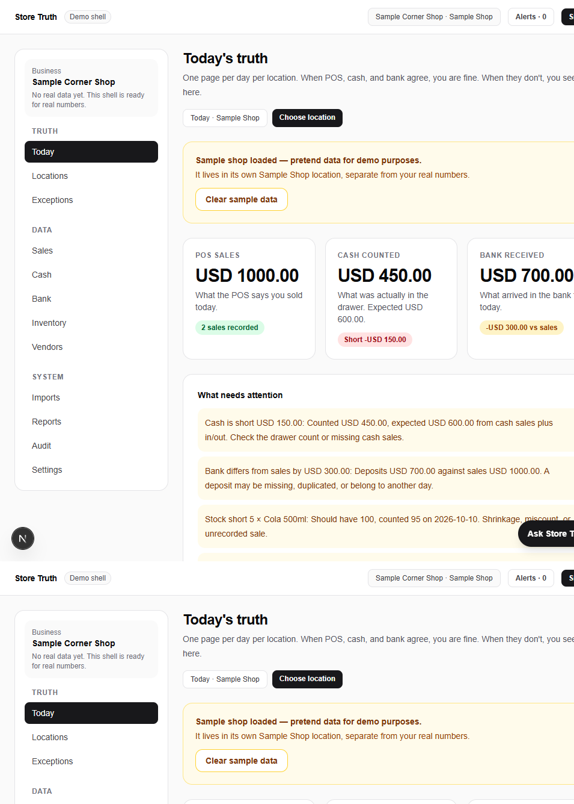

# Store Truth — Small Business POS Reconciliation & Daily Truth App

**The tool that tells a small business what it actually made today.**

Store Truth is an open-source Next.js app that replaces spreadsheet-and-trust chaos for small retail and service businesses. It compares POS sales, cash drawer counts, and bank deposits side by side — per day, per location — and surfaces every mismatch in plain words. No accounting jargon. No hidden formulas.



> Keywords: pos reconciliation, point of sale, small business, retail management, cash reconciliation, bank reconciliation, inventory management, expense tracking, daily sales report, open source, nextjs, ai assistant

## The problem

A shop owner ends the day with four versions of the truth: the POS says $1,000, the drawer holds $850, the bank shows $700, and five sodas are missing. Today that lives in spreadsheets and one person's memory. Store Truth puts all four on one page and flags what does not line up.

## Demo in 10 seconds

1. Run the app, create an account (browser-local demo, no cloud needed).
2. On the home screen click **Load sample shop**.
3. Instantly see: cash $150 short, bank $300 off sales, 5 sodas missing, one unknown $210 bill — each on Today and Exceptions.

Click **Clear sample data** to wipe the pretend shop and enter your own numbers.

## Features

- **Today's truth** — POS sales vs cash counted vs bank received per day per location, with match/mismatch states
- **Cash reconciliation** — expected vs counted cash, in/out tracking, variance in plain words
- **Bank reconciliation** — deposits matched against sales, unmatched money flagged
- **Inventory tracking** — should-have vs counted per item, shrinkage visible
- **Vendor & expense review** — pending/reviewed workflow for unknown or changed vendors
- **CSV import** — POS, bank, inventory, and expense files with column auto-mapping, validation, row-level error review, and import history
- **Multi-location** — separate truth per shop, one-click switching, numbers never merged
- **Exceptions** — every mismatch as a reviewable card linking straight to the fix
- **Reports** — daily close table plus one-click CSV export
- **Audit log** — who added, deleted, imported, or reviewed what, and when
- **AI assistant** — chat panel that records sales/cash/bank/stock/expenses, loads samples, and explains the numbers, with a live transparent step timeline (needs any free OpenAI-compatible key)
- **Settings** — business profile, currency, sample controls, full demo reset

## Tech stack

Next.js 16 (App Router) · React 19 · Tailwind CSS v4 · TypeScript · Browser-local demo storage (no database required) · Optional OpenAI-compatible LLM for the assistant

## Getting started

```bash
npm install
npm run dev
```

Open [http://localhost:3000](http://localhost:3000). Create an account, set up your business and first location, then enter numbers — or load the sample shop.

### AI assistant setup (optional)

```bash
cp .env.example .env.local
```

Fill in `LLM_BASE_URL`, `LLM_MODEL`, and `LLM_API_KEY` in `.env.local` (any free OpenAI-compatible provider works), then restart the dev server. The key stays server-side — the browser only talks to `/api/assistant`.

### CSV import test file

A sample file with valid and broken rows lives at [`public/samples/sales-sample.csv`](public/samples/sales-sample.csv). Upload it at Imports → Sales to see mapping, validation, and review in action.

## Deploy

Any Next.js host works (Vercel, Netlify with the Next.js plugin). Set the `LLM_*` environment variables on the host to enable the assistant in production; the app degrades gracefully without them.

## Roadmap

Real (server) authentication with roles · Cloud database option · Recurring report emails · Barcode inventory · POS/bank integrations. The demo is deliberately local-first so anyone can run and evaluate it in minutes.

## Suggested GitHub topics

`pos` · `point-of-sale` · `small-business` · `retail` · `reconciliation` · `cash-management` · `inventory-management` · `expense-tracking` · `nextjs` · `open-source` · `ai-assistant`
